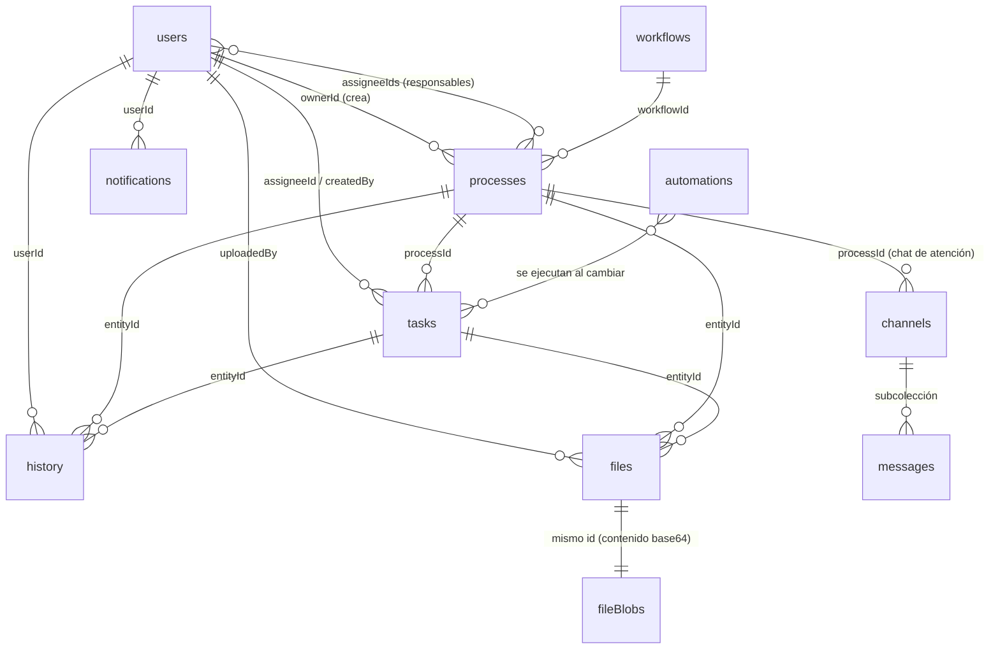

# Esquema de la base de datos (Cloud Firestore)

Firestore es una base de datos de documentos: **no tiene tablas ni columnas fijas**. Este archivo describe los datos que la aplicación espera
(es la versión legible de `database/schema.json`) y cómo subirlos a Firebase desde la terminal.

## Diagrama de relaciones



## Cómo subirlo a Firebase desde la terminal

Requisitos: Node 22+, pnpm y un proyecto de Firebase con **Authentication** (correo y Google) y **Firestore** activados.

```bash
# 1) Validar el esquema sin conectarse a nada
pnpm db:check

# 2) Guardar el esquema en Firestore (documento _meta/schema) y, si quieres, crear el primer administrador
pnpm db:setup --project <id-del-proyecto> --key <clave-de-servicio.json> --admin tu-correo@empresa.co

# 3) Publicar reglas de seguridad e índices (pide iniciar sesión con tu cuenta de Google la primera vez)
pnpm db:deploy
```

- La **clave de servicio** se descarga en Firebase Console → Configuración del proyecto → Cuentas de servicio → *Generar nueva clave privada*. Da acceso total a la base de datos: guárdala fuera del proyecto. `.gitignore` ya ignora los archivos con ese nombre.
- Para usar `--admin`, la persona debe haberse registrado antes en la aplicación (o existir en Authentication).
- Firestore crea cada colección al guardar su primer documento; por eso el script no «crea tablas»: guarda el contrato en `_meta/schema` y las reglas validan el acceso.
- `pnpm db:check` también compara el esquema con `firestore.rules`, y las pruebas (`pnpm test`) lo comparan con los modelos de TypeScript para que no se desincronicen.

## Reglas de lectura y escritura (resumen)

| Colección | Leer | Crear | Editar | Eliminar |
|---|---|---|---|---|
| users | Cualquier sesión | Uno mismo como `member` (el primer usuario de la aplicación como `admin`), o un admin | Un admin, o uno mismo sin cambiar rol ni estado | Un admin (no a sí mismo) |
| _meta | Cualquier sesión | `admin` solo una vez (el primer usuario) | Nadie | Nadie |
| processes | Cuenta activa | admin, manager, member (como dueño) | admin, manager, o dueño/responsable | admin, manager |
| tasks | Cuenta activa | admin, manager, member | admin, manager, member | admin, manager |
| workflows, automations | Cuenta activa | admin, manager | admin, manager | admin, manager |
| notifications | Solo la persona destinataria | admin, manager, member | Solo la persona destinataria | Solo la persona destinataria |
| history | Cuenta activa | admin, manager, member | Nadie | Nadie |
| files, fileBlobs | Cuenta activa | admin, manager, member (como autor) | Nadie | admin, manager, o el autor |
| channels y messages | Cuenta activa | admin, manager, member | admin, manager (canales) | admin, manager |

Una cuenta **desactivada** (`active: false`) no puede leer ni escribir nada, aunque siga existiendo en Authentication.

## Colecciones y campos

### `_meta`

Datos internos: «schema» (versión del esquema, escrito por `db:setup`) y «admin» (marca de que el primer usuario ya reclamó el rol de administrador). Id del documento: «schema» o «admin».

| Campo | Tipo | Obligatorio | Detalle |
|---|---|---|---|
| `version` | number | No | Solo en _meta/schema |
| `uid` | string | No | → users; solo en _meta/admin |
| `createdAt` | number | No | Solo en _meta/admin |

### `users`

Perfil de cada persona. El id del documento es el uid de Firebase Authentication. Id del documento: uid de Firebase Authentication.

| Campo | Tipo | Obligatorio | Detalle |
|---|---|---|---|
| `uid` | string | Sí |  |
| `email` | string | Sí |  |
| `displayName` | string | Sí |  |
| `photoURL` | string|null | No |  |
| `role` | string | Sí | valores: `admin`, `manager`, `member`, `viewer` |
| `active` | boolean | Sí | false = cuenta desactivada: no puede leer ni escribir |
| `position` | string | No | Cargo |
| `createdAt` | number | Sí |  |
| `settings` | map | No |  |
| `settings.chatLang` | string | No | valores: `es`, `en` |
| `settings.notifyAssignments` | boolean | No |  |
| `settings.notifyStatus` | boolean | No |  |
| `settings.dueSoonDays` | number | No |  |

### `processes`

Procesos y solicitudes. Id del documento: generado por Firestore.

| Campo | Tipo | Obligatorio | Detalle |
|---|---|---|---|
| `title` | string | Sí |  |
| `description` | string | Sí |  |
| `kind` | string | Sí | valores: `proceso`, `solicitud` |
| `priority` | string | Sí | valores: `low`, `medium`, `high`, `urgent` |
| `category` | string | Sí |  |
| `status` | string | Sí | Uno de los estados del workflow |
| `workflowId` | string | Sí | → workflows (o «default») |
| `ownerId` | string | Sí | → users |
| `assigneeIds` | array<string> | Sí | → users |
| `startDate` | string | Sí | AAAA-MM-DD o vacío |
| `dueDate` | string | Sí | AAAA-MM-DD o vacío |
| `finishedAt` | number | Sí | 0 mientras siga abierto |
| `aiSummary` | string | Sí |  |
| `createdAt` | number | Sí |  |
| `updatedAt` | number | Sí |  |

### `tasks`

Tareas, con o sin proceso asociado. Id del documento: generado por Firestore.

| Campo | Tipo | Obligatorio | Detalle |
|---|---|---|---|
| `processId` | string | Sí | → processes (vacío si no tiene) |
| `title` | string | Sí |  |
| `description` | string | Sí |  |
| `priority` | string | Sí | valores: `low`, `medium`, `high`, `urgent` |
| `status` | string | Sí | valores: `todo`, `doing`, `review`, `done` |
| `assigneeId` | string | Sí | → users (vacío si no tiene) |
| `dueDate` | string | Sí | AAAA-MM-DD o vacío |
| `completedAt` | number | Sí | 0 mientras siga abierta |
| `createdBy` | string | Sí | → users (o «system») |
| `createdAt` | number | Sí |  |
| `updatedAt` | number | Sí |  |

### `workflows`

Flujos de trabajo personalizados. El flujo «default» vive en el código y no se guarda aquí. Id del documento: generado por Firestore.

| Campo | Tipo | Obligatorio | Detalle |
|---|---|---|---|
| `name` | string | Sí |  |
| `states` | array<string> | Sí | Ordenados; el último es el estado final; mínimo 2 |
| `description` | string | No |  |
| `stuckDays` | number | No | Días en un estado para considerarlo estancado |
| `createdBy` | string | No | → users |

### `automations`

Reglas «cuando pase X, haz Y». Id del documento: generado por Firestore.

| Campo | Tipo | Obligatorio | Detalle |
|---|---|---|---|
| `name` | string | Sí |  |
| `enabled` | boolean | Sí |  |
| `trigger` | map | Sí |  |
| `trigger.type` | string | No | valores: `task_created`, `task_status`, `process_created`, `process_status` |
| `trigger.value` | string | No |  |
| `action` | map | Sí |  |
| `action.type` | string | No | valores: `notify`, `assign`, `set_priority`, `create_task` |
| `action.value` | string | No |  |
| `createdBy` | string | Sí | → users |

### `notifications`

Avisos guardados para una persona. Las alertas de vencimiento no se guardan: se calculan al abrir la app. Id del documento: generado por Firestore.

| Campo | Tipo | Obligatorio | Detalle |
|---|---|---|---|
| `userId` | string | Sí | → users |
| `message` | string | Sí |  |
| `link` | string | Sí | Ruta interna de la app o vacío |
| `read` | boolean | Sí |  |
| `createdAt` | number | Sí |  |

### `history`

Historial de cambios. Solo se agregan documentos: no se editan ni se borran. Id del documento: generado por Firestore.

| Campo | Tipo | Obligatorio | Detalle |
|---|---|---|---|
| `entityType` | string | Sí | valores: `process`, `task`, `user`, `workflow`, `file` |
| `entityId` | string | Sí |  |
| `entityTitle` | string | Sí |  |
| `action` | string | Sí | valores: `create`, `update`, `status`, `assign`, `delete`, `ai`, `automation`, `file` |
| `summary` | string | Sí |  |
| `userId` | string | Sí | → users (o «system») |
| `userName` | string | Sí |  |
| `createdAt` | number | Sí |  |

### `files`

Metadatos de los archivos adjuntos a procesos y tareas. Id del documento: generado por la aplicación.

| Campo | Tipo | Obligatorio | Detalle |
|---|---|---|---|
| `entityType` | string | Sí | valores: `process`, `task` |
| `entityId` | string | Sí |  |
| `entityTitle` | string | Sí |  |
| `name` | string | Sí |  |
| `size` | number | Sí | Bytes |
| `mime` | string | Sí |  |
| `backend` | string | Sí | valores: `firestore`, `storage` |
| `path` | string | Sí | Ruta en Cloud Storage (vacío si backend = firestore) |
| `uploadedBy` | string | Sí | → users |
| `uploaderName` | string | Sí |  |
| `createdAt` | number | Sí |  |

### `fileBlobs`

Contenido (base64) de los archivos cuando el backend es Firestore. Mismo id que el documento de «files». Id del documento: igual al id del documento en files.

| Campo | Tipo | Obligatorio | Detalle |
|---|---|---|---|
| `data` | string | Sí | Archivo en base64 (máx. ~600 KB) |
| `uploadedBy` | string | Sí | → users |

### `channels`

Canales de chat. Si tienen processId, son la conversación de atención de ese proceso. Id del documento: generado por Firestore.

| Campo | Tipo | Obligatorio | Detalle |
|---|---|---|---|
| `name` | string | Sí |  |
| `processId` | string | No | → processes |
| `createdBy` | string | Sí | → users |
| `createdAt` | number | Sí |  |

#### Subcolección `channels/{channelId}/messages`

Mensajes del canal.

| Campo | Tipo | Obligatorio | Detalle |
|---|---|---|---|
| `text` | string | Sí |  |
| `uid` | string | Sí | → users |
| `displayName` | string | Sí |  |
| `createdAt` | number | Sí |  |

## Notas

- Las fechas con hora son números en milisegundos (`Date.now()`); las fechas de calendario son texto `AAAA-MM-DD` o cadena vacía.
- Los opcionales vacíos se guardan como `""` o `0`, no como `null`, para filtrar fácilmente.
- El flujo de trabajo `default` vive en el código (`src/services/workflow.ts`) y no se guarda en `workflows`.
- Las alertas de vencimiento no se guardan: se calculan al abrir la aplicación a partir de procesos y tareas.
- Este esquema no incluye datos de ejemplo: la base empieza vacía y se llena con el uso real.
